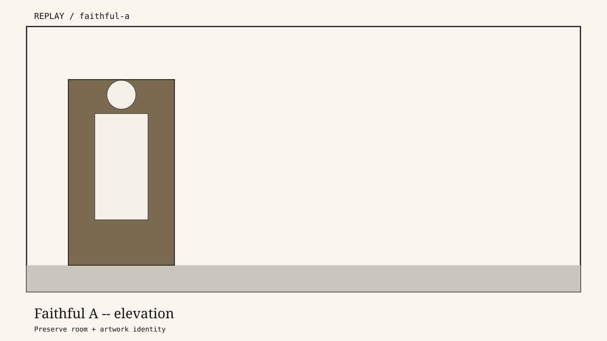

# Moises Sanabria × Krea

**Unofficial application site. Not affiliated with or endorsed by Krea.**

> I turn frontier creative AI into workflows people can trust, learn, and ship with.

Three-minute argument for [Creative Lead @ Krea](https://jobs.ashbyhq.com/krea/1eb60922-3223-45ec-be02-8e43dd9e8764). Positioning: **Creative Systems Lead who codes**.

[Live site](https://moises-for-krea.vercel.app) · [Field Studio replay](https://krea-field-studio.vercel.app/replay) · [Field Studio source](https://github.com/moisestech/krea-field-studio) · [CI](https://github.com/moisestech/krea-field-studio/actions)



## Reviewer path

1. Homepage thesis + visual proof + **Run the 90-second replay**
2. [`/field-studio`](https://moises-for-krea.vercel.app/field-studio) — case with contact sheet, 90-second filmstrip, real/replay/planned matrix
3. Public replay (no login, no spend)
4. Source + CI on GitHub

## Status

| Surface | Claim |
| --- | --- |
| Application site | **LIVE** at Vercel URL (`krea.moises.tech` pending DNS) |
| Field Studio replay | **REPLAY / live on the web** |
| Field Studio source + CI | **LIVE** |
| Recorded Krea API generation | **PLANNED** until a reviewed live artifact exists |
| Agentic Evidence Pipeline | **LIVE SOURCE** |

## Routes

`/` · `/field-studio` · `/evidence` · `/work/lore-machine` · `/work/oolite-digital-lab` · `/work/ai24-social-orchestra` · `/technical-notes`

## Local

```bash
npm install
npm run dev
npm run check
npm run build
npm run test:e2e
```

## Claims

Every card is labeled **live**, **replay**, **case study**, **building**, or **planned**. Replay frames are never relabeled live.

## Location

Miami-based. Prepared to relocate to San Francisco for this role.
